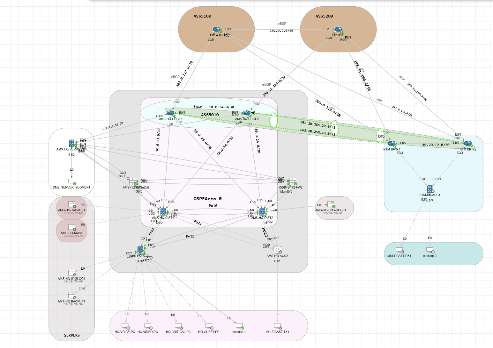

# CCNP Enterprise Campus & WAN Lab

**Cisco CML Personal | Enterprise campus, dual-ISP WAN, branch connectivity and perimeter security**

A hands-on enterprise lab focused on **design, configuration and observable network behavior**. The public portfolio highlights **completed and tested scenarios**; full sanitized configurations and additional engineering documentation are also available.

## Topology

Amsterdam HQ (AS 65010), Rotterdam branch (AS 65020), two simulated providers (AS 65100 / 65200), redundant distribution and edge, Cisco ASA Active/Standby, DMZ and infrastructure services.

## Verified implementation highlights

| Lab scenario | Observed result |
| --- | --- |
| **ASA stateful failover** | The pre-existing TCP connection survived FW1 → FW2 role change; HTTP GET over the same session returned **200 OK** |
| **DMZ static NAT** | Internal HTTP service `172.16.70.10:8080` published and reached at `192.0.2.22:8080` |
| **HQ source PAT** | VLAN 10 client `10.10.10.138` translated through `192.0.2.20`; **173/173** ICMP replies in the recorded test |
| **HSRP first-hop redundancy** | DIST1 → DIST2 VLAN 10 gateway switchover, **zero ping loss observed in that test** |
| **ASA access-control validation** | Five final positive/negative `packet-tracer` scenarios returned expected allow/deny decisions |

**[View validated project results](docs/ccnp-lab-design-summary-2026-11-09.md)**

These outcomes are from documented CML testing. They are **scenario-specific**, rather than claims of universal availability or end-to-end validation of every configured feature.

## Network implementation and evidence

| Area | Material |
| --- | --- |
| **Verification gallery / LinkedIn evidence plan** | [NAT, xlate, conn, QoS, traceroute, OSPF, BGP, ISAKMP, IPsec and HSRP](evidence/README.md) |
| **HQ campus** | [Switching, trunks, EtherChannel, HSRP and OSPF](docs/hq-switching-implementation.md) |
| **WAN / branch** | [BGP, OSPF, GRE/IPsec and configured QoS/PBR](docs/wan-branch-implementation.md) |
| **ASA** | [Stateful TCP failover test details](docs/asa-stateful-tcp-failover.md) |
| **Sanitized configurations** | [20 original saved node files, organized by device](configs/) |

The 9 November 2026 CML export contains **28 nodes, 52 links and 20 saved configuration files from 18 nodes**. Interfaces and non-sensitive commands are retained in the public snapshots. Credentials and PKI material are excluded; these files are **not deployable backups**. The original CML YAML is not published.

**Evidence policy:** Routing neighbor state, IPsec packet counters, QoS treatment and traceroute screenshots will be added only after their real CLI output is captured. A configured feature is not represented as an operationally verified milestone merely because it appears in a saved configuration.

## Environment

Cisco CML Personal 2.10.0+build.13 · Windows 11 Pro host · 32 GB RAM.

## Related practice labs

- [BGP CML Labs](https://github.com/enisalushi/ccnp-bgp-cml-labs)
- [QoS Enterprise / Service Provider Lab](https://github.com/enisalushi/cisco-qos-enterprise-sp-lab)
- [OSPF Multi-Area Lab](https://github.com/enisalushi/ospf-multi-area-lab)

*Technical learning portfolio. Lab results and documentation represent the tests described, not a production deployment.*
