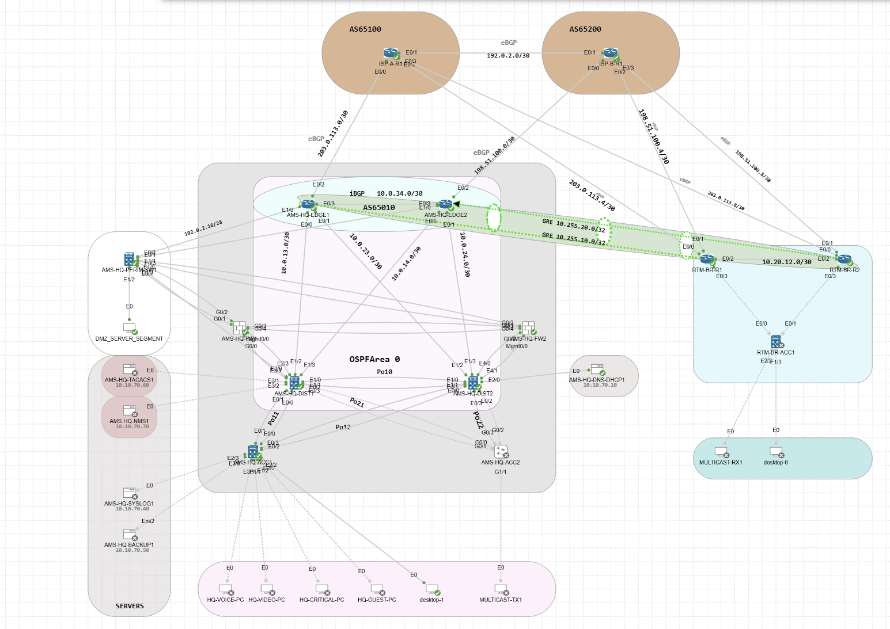

# Enterprise Campus & WAN Lab — Validated Implementations

**Cisco Modeling Labs Personal | Amsterdam HQ · Rotterdam Branch · Dual ISPs**

This page showcases **completed, tested scenarios** from my enterprise networking lab. The emphasis is on packet forwarding, redundancy and security behavior—not on configuration snippets alone.

## Project architecture

An enterprise HQ and branch connected through two simulated ISP domains, with dual campus distribution switches, edge routers, VLAN segmentation, a DMZ and a Cisco ASA Active/Standby firewall pair.

- **HQ:** AS 65010 · **Branch:** AS 65020 · **ISP A / B:** AS 65100 / 65200
- Built in **Cisco CML Personal**; [sanitized device configurations](../configs/) are available for technical review.

## Completed and validated scenarios

### 1. ASA Stateful Failover — Existing TCP Session Preserved

**Objective:** Demonstrate stateful firewall redundancy using an existing connection, rather than simply opening a new connection after failover.

**Test:** A TCP session was opened from HQ EDGE1 (`192.0.2.18`) to a DMZ Python HTTP service published at `192.0.2.22:8080`. ASA failover was then triggered while the connection was established.

**Observed result:** FW2 became Active, retained the original connection state, and the HTTP GET over the **same TCP session** returned **200 OK**.

**Demonstrated:** Connection-state replication and continued application communication for the tested flow.

[Detailed experiment and commands](asa-stateful-tcp-failover.md)

### 2. Static NAT — Publishing a DMZ HTTP Service

**Objective:** Make an internal application reachable through the firewall's outside interface.

| Element | Address |
| --- | --- |
| Internal DMZ server | `172.16.70.10:8080` |
| Published outside endpoint | `192.0.2.22:8080` |
| External test client | HQ EDGE1, `192.0.2.18` |

**Observed result:** The published service responded to the external test, including **HTTP 200 OK** during the stateful connection test.

**Demonstrated:** Static NAT and the permitted outside-to-DMZ application path.

### 3. Dynamic PAT — HQ Client Internet Breakout

**Objective:** Validate source translation for HQ user traffic routed through the ASA.

**Test:** HQ VLAN 10 client `10.10.10.138` sent Internet-bound ICMP traffic through the perimeter firewall.

**Observed result:** Translation through the ASA outside address `192.0.2.20` and **173/173 successful ICMP replies** in the recorded test.

**Demonstrated:** Dynamic PAT and connectivity for the tested HQ client flow.

### 4. HSRP — Distribution Gateway Failover

**Objective:** Validate default-gateway redundancy between HQ distribution switches.

**Test:** The VLAN 10 active HSRP gateway was moved from **AMS-HQ-DIST1** to **AMS-HQ-DIST2** during a continuous-ping test.

**Observed result:** The gateway role changed and **zero ICMP packets were lost in that run**.

**Demonstrated:** HSRP first-hop failover for the tested VLAN and traffic flow.

### 5. ASA Access Control — Positive and Negative Policy Tests

**Objective:** Validate segmentation and published-service access, including traffic that should be blocked.

Five final ASA `packet-tracer` scenarios matched the expected outcomes:

| Traffic | Expected and observed result |
| --- | --- |
| HQ user VLAN 10 → DMZ HTTPS (`443`) | **ALLOW** |
| HQ guest VLAN 60 → DMZ HTTP (`8080`) | **DROP** |
| HQ video VLAN 30 → external HTTPS (`443`) | **ALLOW** |
| Branch VLAN 120 → external HTTPS (`443`) | **ALLOW** |
| Outside EDGE1 → published DMZ HTTP (`192.0.2.22:8080`) | **ALLOW** |

**Demonstrated:** The configured ASA policy logic behaved as expected in these **packet-tracer simulations**. The branch policy simulation is not presented as an independent live branch-client Internet test.

## Verification gallery

The [evidence capture and screenshot guide](../evidence/README.md) defines the exact command outputs and image captions for **NAT, xlate, conn, HSRP, traceroute, OSPF, BGP, IKEv1/IPsec and QoS**.

Only the topology image is published so far. Screenshots of CLI outputs will be added after capture; **no terminal output or proof images are fabricated**. Each photo will demonstrate a specific observed state, and protocol topics will be added to this completed-project showcase only after their outputs confirm the expected behavior.

## Implementation sources

- [Sanitized configurations for HQ, branch, ISP, ASA and services](../configs/)
- [ASA stateful failover test procedure](asa-stateful-tcp-failover.md)
- [CML architecture and device inventory](architecture.md)
- [Screenshot gallery and LinkedIn presentation plan](../evidence/README.md)

*Validation results above are sourced from the lab's previously recorded tests. They describe the exact scenarios exercised, not universal uptime, zero packet loss for all traffic, or operational verification of every configured protocol.*
