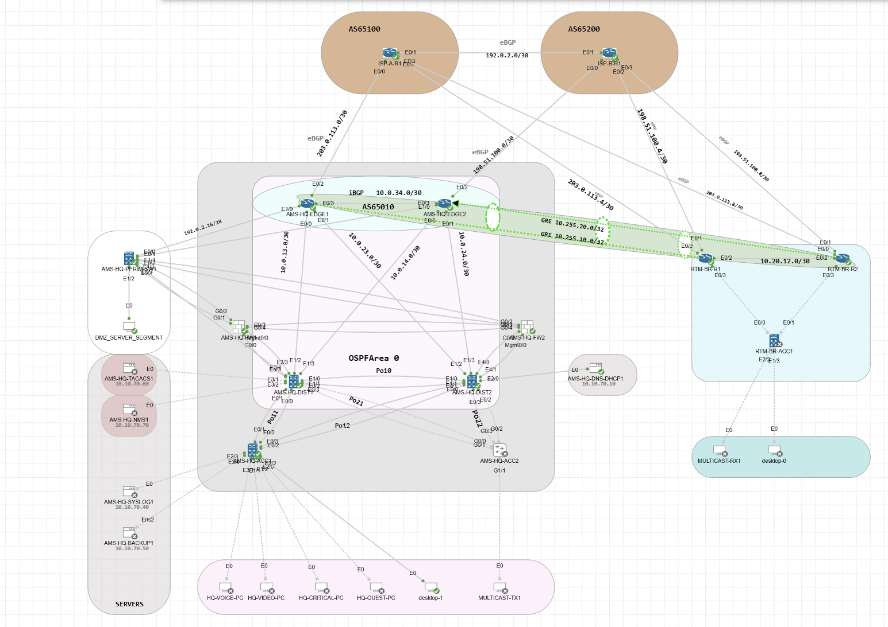
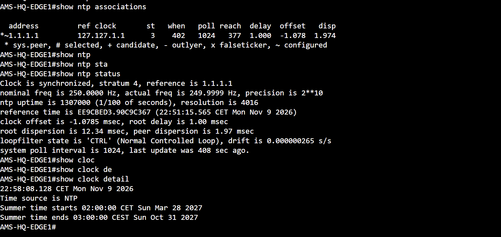
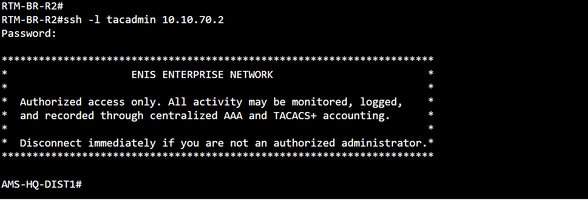
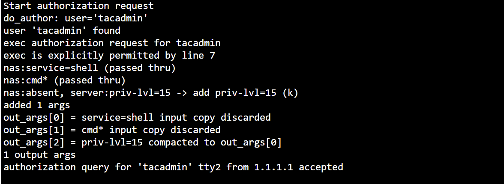

# CCNP Enterprise Campus — Verified CLI Evidence

**29 real Cisco CML screenshots**, organized by technical area. Each folder includes the original images and captions explaining **command, observed output and what the result proves**.

## Evidence library

| Area | Screenshots | Verified content |
| --- | ---: | --- |
| [Campus switching & redundancy](campus/) | 3 | ACC1 LACP Po11/Po12, HQ HSRP roles, branch VRRP Master state |
| [Routing & forwarding](routing/) | 11 | OSPF FULL, BGP Established, ISP IP SLA/track, installed routes, branch-to-HQ traceroute |
| [GRE / IKE / IPsec](vpn/) | 3 | IKEv1 QM_IDLE and nonzero ESP encapsulation/decapsulation on both branch VPN paths |
| [QoS](qos/) | 3 | 1 Mbps WAN shaper attachment and counters; tunnel priority classes with **zero matching packets** |
| [ASA security & NAT](security/) | 6 | ASA Active/Standby Ready, NAT, live PAT xlate, ACL hit counts, HTTP 200 OK, ICMP conn |
| [Enterprise services](services/) | 3 | EDGE1 NTP synchronized; branch-to-HQ SSH login; accepted TACACS+ EXEC authorization |

### Enterprise services — newly added

**NTP**: EDGE1 is synchronized to lab peer `1.1.1.1`, stratum 4, with NTP as its clock source.

**SSH and TACACS+**: BR-R2 successfully reached DIST1 via SSH, and the TACACS+ server accepted an EXEC authorization for privilege level 15.

[Read detailed NTP and AAA results](services/README.md)

## LinkedIn shortlist — select, don't overload

Suggested **7–8 visuals** for a technical carousel:

1. **Topology** — enterprise architecture, HQ, branch, two ISPs, ASA HA
2. **OSPF and BGP** — FULL adjacencies and Established eBGP on different devices
3. **IKE/IPsec** — BR-R1 and BR-R2 SAs with actual accumulated encrypted/decrypted packet counters
4. **WAN QoS** — 1 Mbps shaper policy and output counters, **not** unverified EF/AF41 classification under load
5. **Routing path** — branch-to-HQ traceroute over the routed GRE path
6. **ASA NAT** — static DMZ mapping plus live HQ source PAT xlate
7. **ASA High Availability** — Active/Standby Ready, with separate application-level HTTP 200 proof
8. **Campus resilience** — LACP bundles and HSRP role snapshot

NTP and TACACS+ are excellent supporting engineering evidence in GitHub; use them as optional LinkedIn slides if you want to show enterprise management and operational hygiene rather than extending the main carousel to 10+ slides.

## Evidence rules

- These are original user-supplied console screenshots, **not generated output**.
- A configured policy is distinct from actual matching traffic or validated failure recovery.
- `show conn` in the currently published security gallery records **ICMP**, not the original established **TCP session** used in the prior ASA stateful failover experiment.
- VPN nonzero SA counters prove earlier protected traffic, **not a measured before/after delta**.
- No YAML, authentication secrets, private certificates or operational passwords are published.

[Command collection guide for future tests](capture-guide.md) · [Validated project showcase](../docs/ccnp-lab-design-summary-2026-11-09.md)
