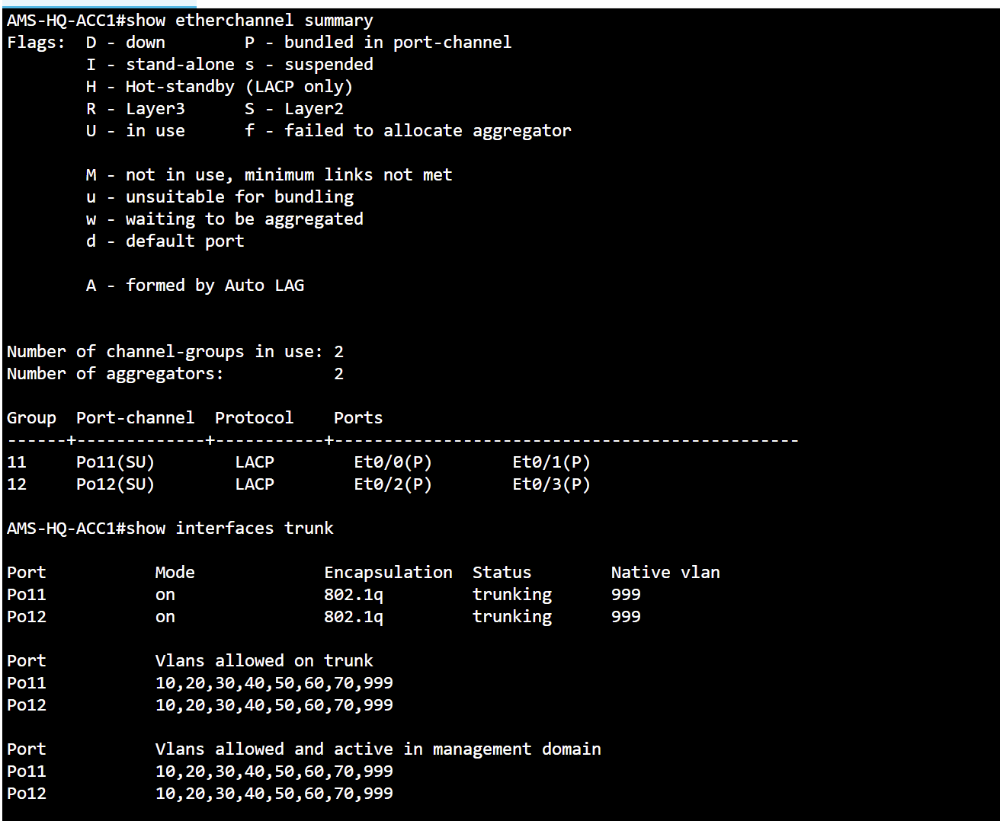
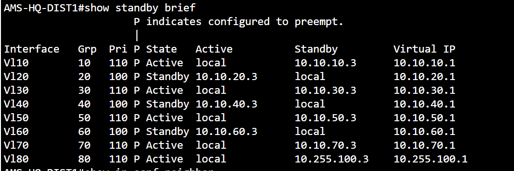
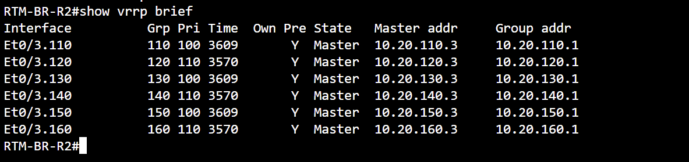

# CAMPUS — Real CML command evidence

**Campus L2 and first-hop redundancy:** operational EtherChannel state and HSRP/VRRP role snapshots. A role snapshot must not be confused with a controlled failover convergence test.

[Back to evidence index](../README.md) · [Project summary](../../docs/ccnp-lab-design-summary-2026-11-09.md)

## LACP bundles and 802.1Q trunks

**Command:** `show etherchannel summary / show interfaces trunk`

**Observed:** Po11(SU) and Po12(SU) use LACP. Et0/0–Et0/3 are bundled (P). Both Port-Channels trunk VLANs 10,20,30,40,50,60,70,999, native VLAN 999.

*Interpretation / limit:* Operational bundled state observed; does not prove physical failure recovery.

## HQ HSRP gateway roles

**Command:** `show standby brief`

**Observed:** DIST1 Active for VLANs 10,30,50,70,80; Standby for 20,40,60. HSRP VIPs displayed.

*Interpretation / limit:* Role snapshot; zero-loss switchover is established by a separate earlier test, not this capture alone.

## Branch VRRP gateway roles

**Command:** `show vrrp brief`

**Observed:** BR-R2 displayed Master status for VLANs 110,120,130,140,150,160 with corresponding virtual IPs.

*Interpretation / limit:* Snapshot of Master state, not evidence of a VRRP failover event.
