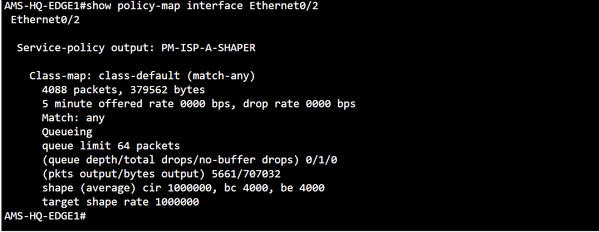
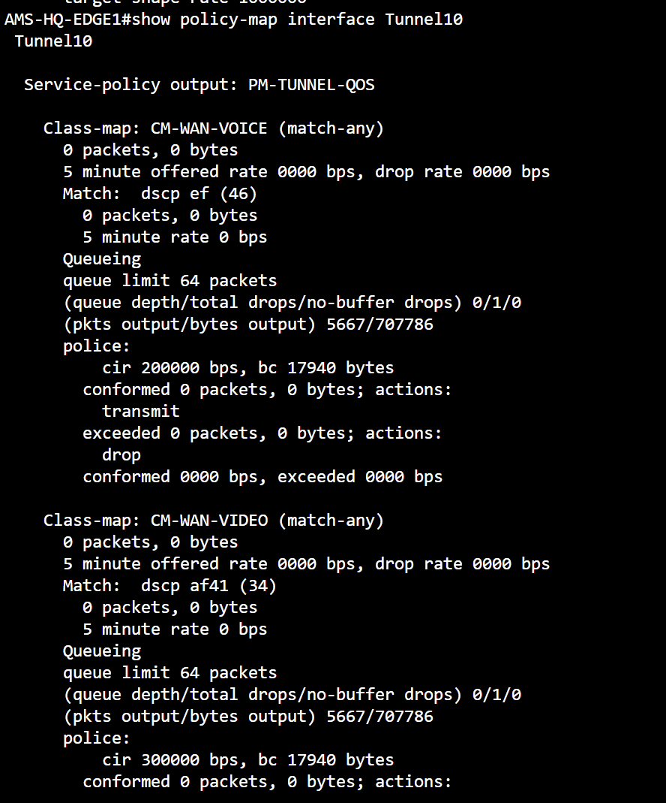
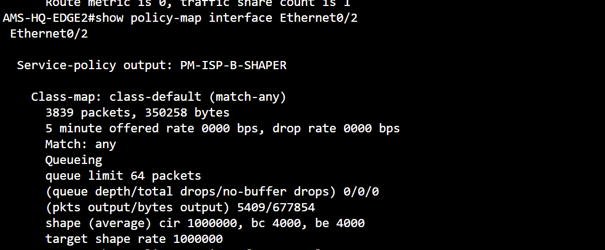

# QOS — Real CML command evidence

**QoS state:** WAN output shapers show the 1 Mbps configured rate and output counts. Tunnel10 priority-class counters are zero in the capture; classification under differentiated traffic is not yet proven.

[Back to evidence index](../README.md) · [Project summary](../../docs/ccnp-lab-design-summary-2026-11-09.md)

## ISP-A WAN output shaper

**Command:** `show policy-map interface Ethernet0/2`

**Observed:** PM-ISP-A-SHAPER applied; class-default 4,088 matched packets; target shaping rate 1,000,000 bps. 5-minute offered rate currently zero.

*Interpretation / limit:* Policy and counters visible; not a measured 1 Mbps saturation test.

## Tunnel10 differentiated QoS policy

**Command:** `show policy-map interface Tunnel10`

**Observed:** PM-TUNNEL-QOS applied; EF and AF41 priority class matching counters are 0 in the capture.

*Interpretation / limit:* Configuration attachment demonstrated; voice/video classification and enforcement under load remain unverified.

## ISP-B WAN output shaper

**Command:** `show policy-map interface Ethernet0/2`

**Observed:** PM-ISP-B-SHAPER applied; class-default 3,839 matched packets; target shaping rate 1,000,000 bps.

*Interpretation / limit:* Shaper policy and output counts shown; no saturation/priority test.
