# ROUTING — Real CML command evidence

**Control-plane and forwarding validation:** OSPF FULL, BGP Established, tracked ISP reachability, installed default routes and the observed branch-to-HQ traceroute. BGP prefix counts reflect each peer, not one global route count.

[Back to evidence index](../README.md) · [Project summary](../../docs/ccnp-lab-design-summary-2026-11-09.md)

## OSPF FULL adjacency at distribution

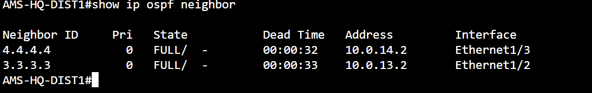

**Command:** `show ip ospf neighbor`

**Observed:** DIST1 neighbor IDs 3.3.3.3 and 4.4.4.4 both FULL on Ethernet1/2 and Ethernet1/3.

*Interpretation / limit:* Adjacency established; routing/forwarding for every subnet requires separate route checks.

## HQ OSPF and GRE adjacency

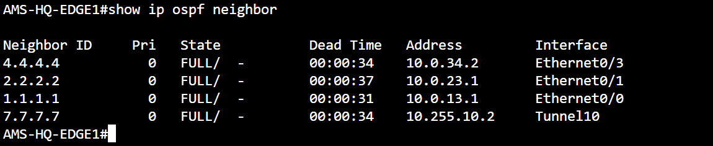

**Command:** `show ip ospf neighbor`

**Observed:** EDGE1 has FULL adjacencies with 1.1.1.1, 2.2.2.2, 4.4.4.4 and branch 7.7.7.7 over Tunnel10.

*Interpretation / limit:* Tunnel10 adjacency proves routed protocol reachability; encryption evidence is captured separately.

## HQ EDGE1 BGP sessions

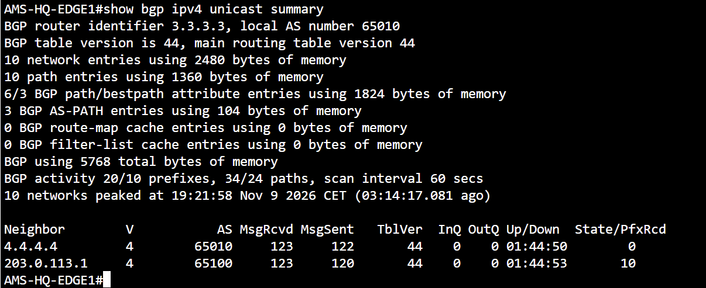

**Command:** `show bgp ipv4 unicast summary`

**Observed:** EDGE1 iBGP peer 4.4.4.4 is Established (0 prefixes received); ISP-A peer 203.0.113.1 in AS65100 is Established (10 received prefixes).

*Interpretation / limit:* An Established session with 0 prefixes is not a failed session; check intended advertisement policy.

## ISP-A health tracking

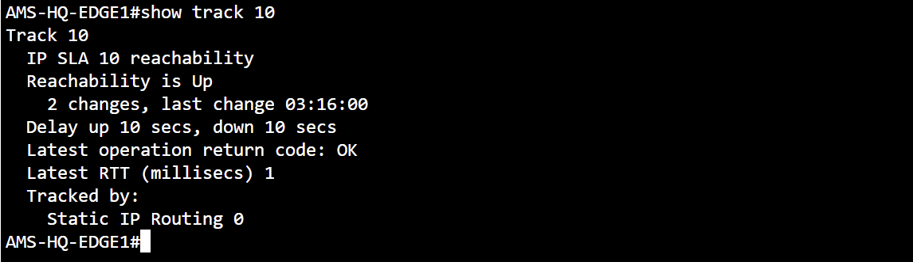

**Command:** `show track 10`

**Observed:** Track 10 reachability Up; latest IP SLA return OK and last RTT 1 ms.

*Interpretation / limit:* Proves the tracking object was Up when captured, not route withdrawal during outage.

## Installed ISP-A default route

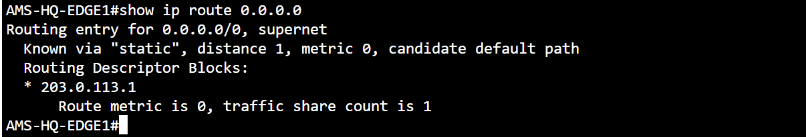

**Command:** `show ip route 0.0.0.0`

**Observed:** Static default via 203.0.113.1, administrative distance 1.

*Interpretation / limit:* Installed route observed; outage convergence requires a separate controlled test.

## HQ EDGE2 BGP sessions

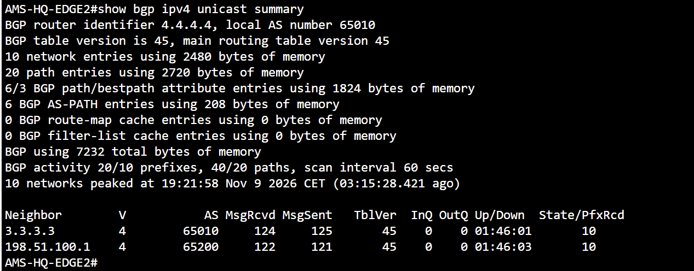

**Command:** `show bgp ipv4 unicast summary`

**Observed:** EDGE2 iBGP peer 3.3.3.3 Established with 10 prefixes; ISP-B peer 198.51.100.1 in AS65200 Established with 10 prefixes.

*Interpretation / limit:* Shows independent ISP-B path and iBGP control-plane state.

## ISP-B health tracking

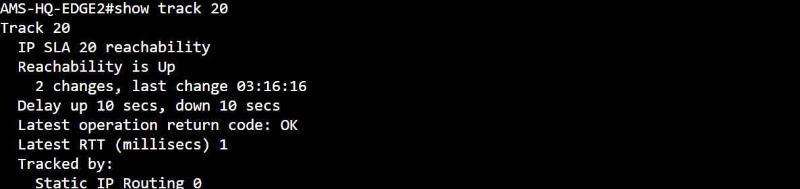

**Command:** `show track 20`

**Observed:** Track 20 reachability Up; IP SLA 20 latest return OK and RTT 1 ms.

*Interpretation / limit:* Current tracking state only, not an outage test.

## Installed ISP-B default route

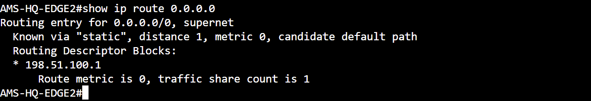

**Command:** `show ip route 0.0.0.0`

**Observed:** Static default via ISP-B next hop 198.51.100.1, administrative distance 1.

*Interpretation / limit:* Route installation observed; failover transition not shown.

## Branch OSPF adjacencies

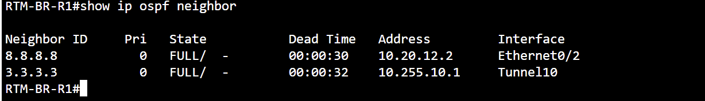

**Command:** `show ip ospf neighbor`

**Observed:** BR-R1 has FULL neighbors 8.8.8.8 over Ethernet0/2 and 3.3.3.3 across Tunnel10.

*Interpretation / limit:* GRE routing adjacency, with IPsec counters documented separately.

## OSPF route to HQ services

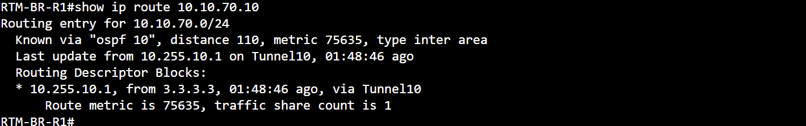

**Command:** `show ip route 10.10.70.10`

**Observed:** BR-R1 learns 10.10.70.0/24 via OSPF inter-area, AD 110, next-hop 10.255.10.1 on Tunnel10.

*Interpretation / limit:* Control-plane route installation; corroborated by traceroute.

## Branch-to-HQ forwarding path

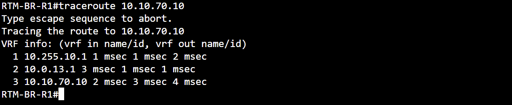

**Command:** `traceroute 10.10.70.10`

**Observed:** BR-R1 reached 10.10.70.10 in 3 hops: 10.255.10.1 → 10.0.13.1 → 10.10.70.10; 1–4 ms hop replies.

*Interpretation / limit:* Shows the observed Layer 3 path, not proof of IPsec without the separate SA evidence.
