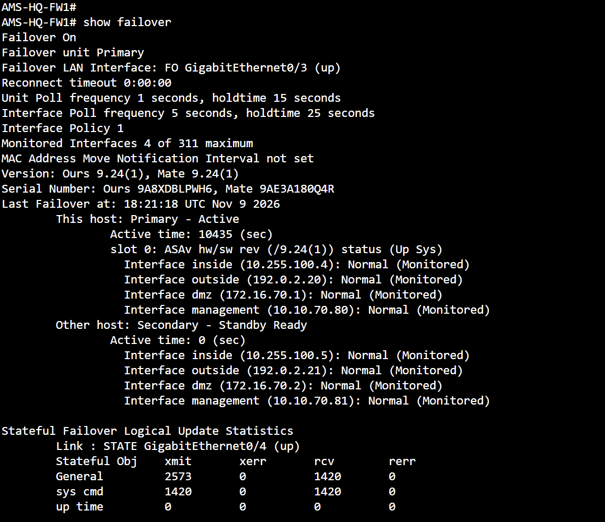
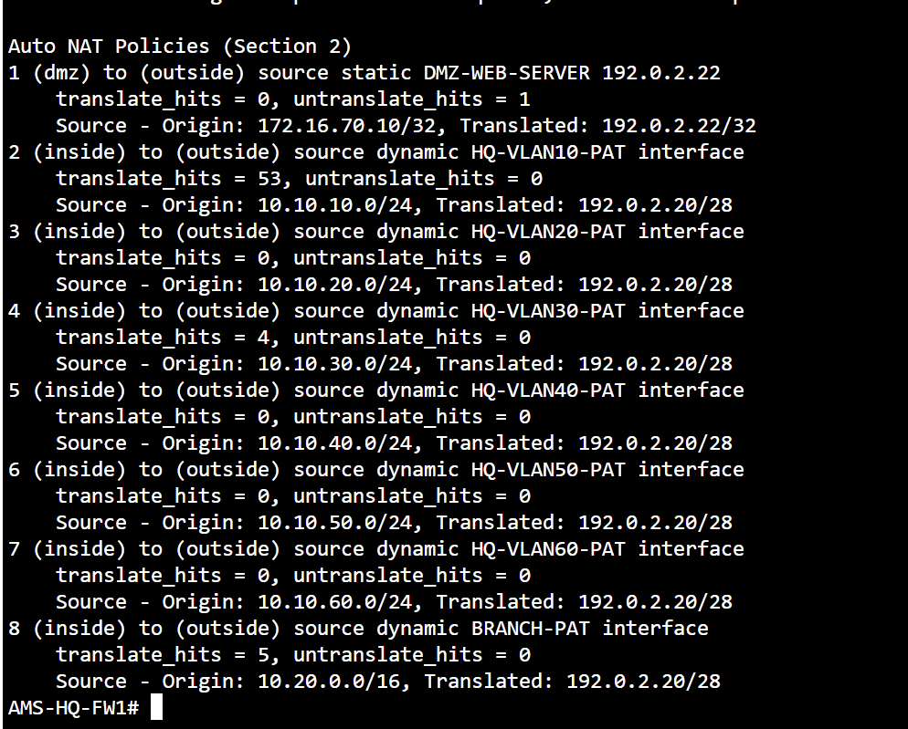
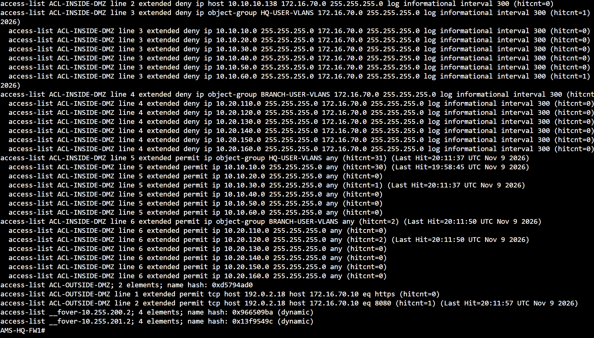
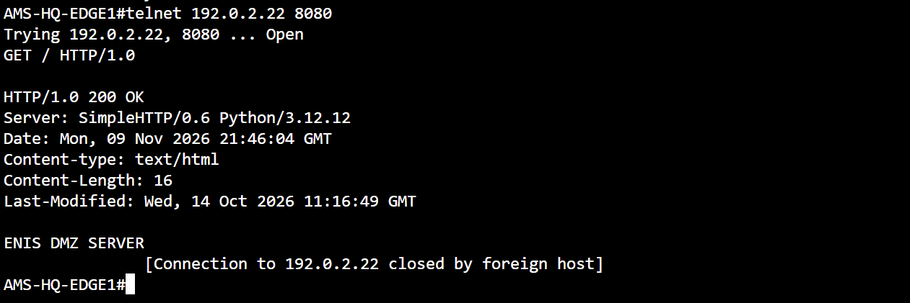
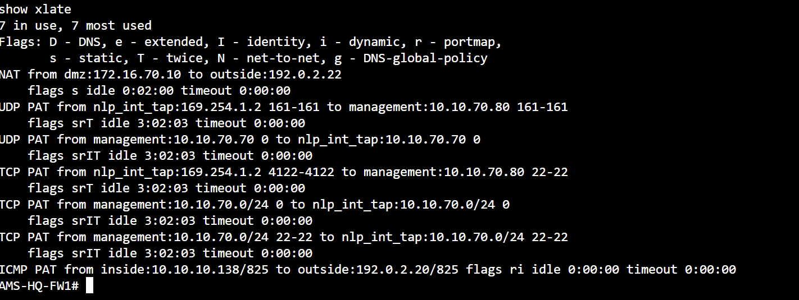
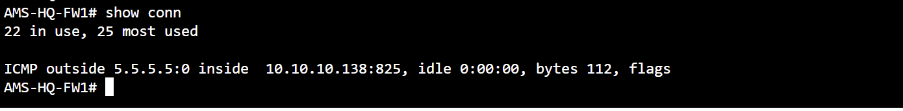

# SECURITY — Real CML command evidence

**ASA firewall security:** Active/Standby state, static DMZ translation, source PAT, ACL hit counts, a real HTTP 200 response and ICMP connection-table state. Do not mislabel the ICMP conn screenshot as the previously proven TCP failover session.

[Back to evidence index](../README.md) · [Project summary](../../docs/ccnp-lab-design-summary-2026-11-09.md)

## ASA firewall HA operational state

**Command:** `show failover`

**Observed:** FW1 Primary Active, FW2 Secondary Standby Ready; interface monitoring Normal, failover LAN and stateful link Up.

*Interpretation / limit:* Readiness and state-sync link shown; existing-TCP survival is from a separate earlier experiment.

## ASA NAT policies and rule hit counts

**Command:** `show nat detail`

**Observed:** DMZ 172.16.70.10 is statically mapped to 192.0.2.22. HQ VLAN10 dynamic PAT has 53 translation hits and Branch PAT has 5.

*Interpretation / limit:* Static NAT rule has 0 translate hits in this snapshot; successful HTTP and static xlate are evidenced separately.

## ASA access-control hit counters

**Command:** `show access-list`

**Observed:** Captured subset includes HQ and branch permit hit counters plus outside-to-DMZ TCP/8080 permit hit count 1.

*Interpretation / limit:* The screenshot begins partway through output. Treat as supplementary, not complete ACL/packet-tracer evidence.

## Published DMZ HTTP application test

**Command:** `telnet 192.0.2.22 8080 and GET / HTTP/1.0`

**Observed:** EDGE1 TCP connection opened; DMZ Python SimpleHTTP server returned HTTP/1.0 200 OK and ENIS DMZ SERVER.

*Interpretation / limit:* Live application response proves reachability through the published endpoint for this flow.

## Active static NAT and dynamic PAT translations

**Command:** `show xlate`

**Observed:** Static mapping DMZ 172.16.70.10 → outside 192.0.2.22 plus live ICMP PAT inside 10.10.10.138/825 → outside 192.0.2.20/825.

*Interpretation / limit:* Real xlate entry confirms PAT state; transient entries depend on traffic timing.

## ASA ICMP connection-table state

**Command:** `show conn`

**Observed:** Connection entry shows ICMP test traffic between HQ 10.10.10.138 and test destination 5.5.5.5.

*Interpretation / limit:* This is ICMP, NOT the pre-existing TCP session used in the stateful HTTP failover experiment.
