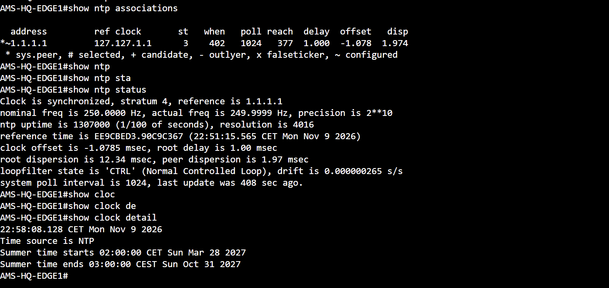
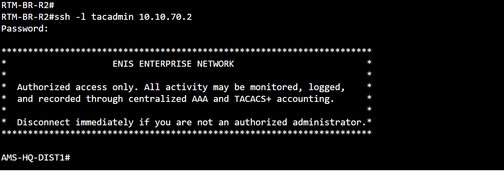
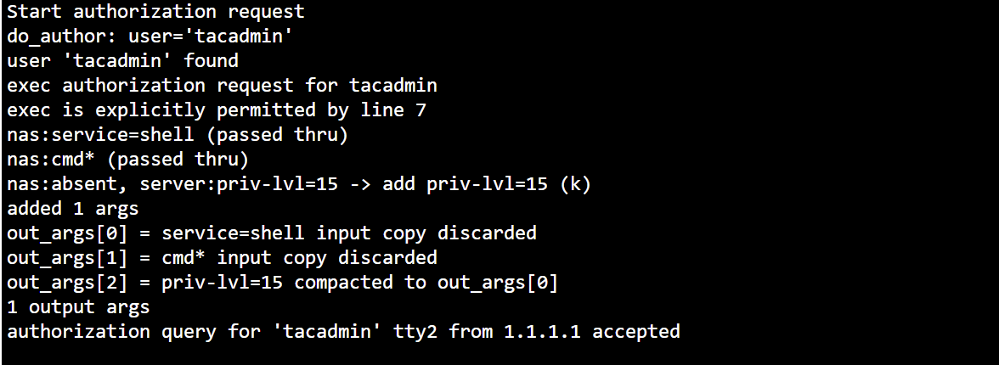

# Enterprise Services — NTP and Centralized AAA

**Source:** Real Cisco CML console captures supplied on 9 November 2026. Screenshots are preserved without editing their command output.

[Evidence index](../README.md) · [CCNP Lab Design Summary](../../docs/ccnp-lab-design-summary-2026-11-09.md)

## NTP — EDGE1 synchronized to the lab time source



**Device:** `AMS-HQ-EDGE1`

**Commands (Privileged EXEC):**

```cisco
show ntp associations
show ntp status
show clock detail
```

**Observed result:**

- Selected system peer: **`1.1.1.1`** (`*~`), reach **377** (octal).
- Local status: **Clock is synchronized, stratum 4**, reference `1.1.1.1`.
- Clock offset: approximately **-1.0785 ms**; root delay **1 ms**.
- `show clock detail`: time source **NTP**, CET timezone.

**Significance:** EDGE1 is synchronized to the internal lab time hierarchy. This is **not evidence of synchronization to an external public NTP service**; the observed peer is `1.1.1.1`, the lab distribution node's loopback.

## SSH — Branch administrator reaches HQ distribution



**Client:** `RTM-BR-R2` · **Target:** `AMS-HQ-DIST1` (`10.10.70.2`).

**Command (Privileged EXEC on RTM-BR-R2):**

```cisco
ssh -l tacadmin 10.10.70.2
```

**Observed result:** A password prompt followed by the lab's authorized-access banner and the **`AMS-HQ-DIST1#`** EXEC prompt.

**Significance:** Remote management connectivity and successful authenticated SSH access to the HQ distribution switch were observed. The screenshot does not reveal the password.

## TACACS+ — EXEC authorization accepted



**Source:** TACACS+ server debug/log output, displaying authorization processing for the lab account.

**Observed result:** The server recognized **`tacadmin`**, processed an **EXEC authorization** request, assigned **`priv-lvl=15`**, and recorded **`authorization query ... from 1.1.1.1 accepted`**.

**Significance:** Centralized administrative **EXEC authorization** was accepted for the switch with source address `1.1.1.1`. Combined with the SSH session image, this illustrates the lab's remote administration and centralized AAA design.

**Evidence boundary:** This log does **not by itself** prove that every EXEC command generated an accounting record; a separate TACACS+ accounting/log capture would be needed. The two screenshots do not expose a common timestamp tying each event to one specific SSH session.

## Security and reuse

The screenshots show an intentionally configured lab username but **no password, TACACS shared secret or credential hash**. Avoid adding sensitive operational credentials when capturing follow-up proof.

For **LinkedIn**, this pair of enterprise-services topics is useful as an optional technical appendix. The strongest main-carousel images remain the topology, working routing/VPN, NAT, HTTP and ASA availability demonstrations.
