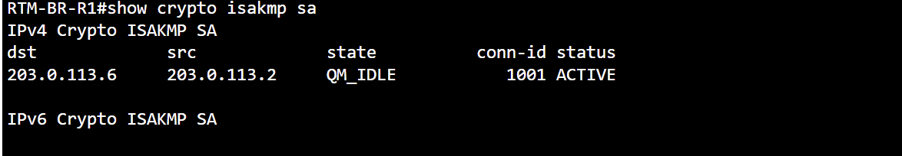
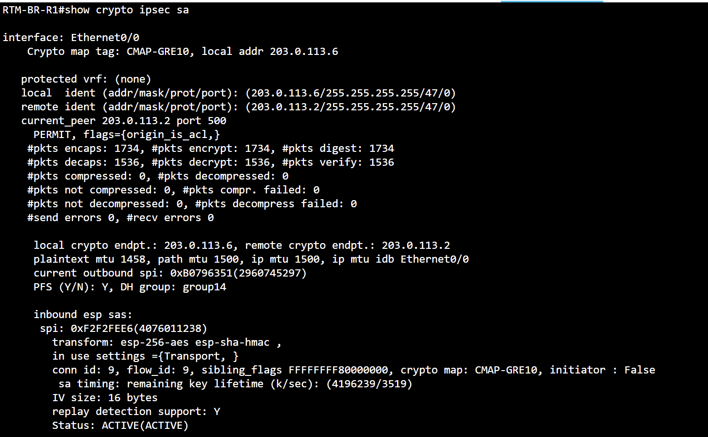
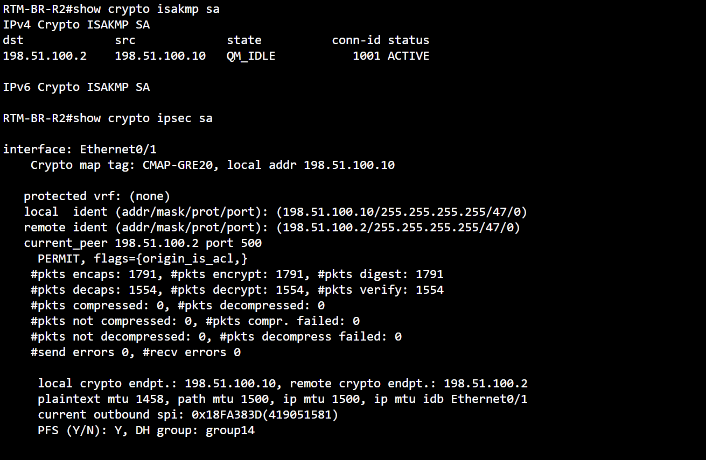

# GRE / IPsec — Real CML command evidence

**GRE over IPsec evidence:** IKEv1 QM_IDLE and nonzero ESP packet counters on both branch VPN paths. These are accumulated counters, not timed deltas.

[Back to evidence index](../README.md) · [Project summary](../../docs/ccnp-lab-design-summary-2026-11-09.md)

## Primary IKEv1 SA

**Command:** `show crypto isakmp sa`

**Observed:** BR-R1 to HQ EDGE1 peer 203.0.113.2 shows QM_IDLE, ACTIVE.

*Interpretation / limit:* IKE negotiation established; ESP packet counters provide separate data-plane evidence.

## Primary IPsec ESP counters

**Command:** `show crypto ipsec sa`

**Observed:** BR-R1 outbound 1,734 encrypted/encapsulated packets; inbound 1,536 decrypted/decapsulated packets; zero send/receive errors.

*Interpretation / limit:* Nonzero accumulated counters show protected traffic has passed, not a before/after increment measurement.

## Backup IPsec SA and counters

**Command:** `show crypto isakmp sa / show crypto ipsec sa`

**Observed:** BR-R2 QM_IDLE active SA; 1,791 packets encapsulated and 1,554 decapsulated, no send/receive errors shown.

*Interpretation / limit:* Confirms traffic historically protected on second tunnel, not an automatic failover event.
