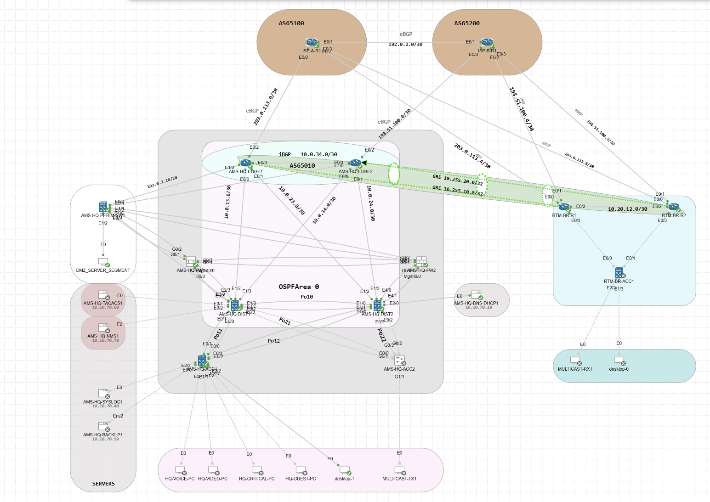

# Topology

This screenshot was updated on **9 November 2026**. It is the current supplied Cisco CML topology image for the evolving Amsterdam HQ, Rotterdam branch and dual-ISP campus lab.

The image documents the updated lab layout; archived configurations under `configs/` were exported on 2 November 2026. Device configurations, routing adjacencies and feature verification are tracked in the parent repository and `docs/`.

The Cisco CML YAML export is intentionally not published.
